<p align="center"><b>简体中文</b> | <a href="README_en.md">English</a></p>

<h1 align="center">Vibe Research</h1>

<p align="center">
  <b>A 股、美股、港股的投研工作台</b><br>
  自选与持仓 · 每日复盘 · 产业资讯 · 产业研究 · 个股深挖 · 回测 · 研报库 · 168 个数据端点
</p>

<p align="center">
  <a href="LICENSE"></a>
  <a href="CHANGELOG.md"></a>
  
  
  
</p>

---

<p align="center">
  <a href="https://viberesearch.wiki">官方网站</a> ·
  <a href="#界面预览">界面预览</a> ·
  <a href="#功能">功能</a> ·
  <a href="#数据与市场">数据</a> ·
  <a href="#支持的-ai">支持的 AI</a> ·
  <a href="#快速开始">快速开始</a> ·
  <a href="#安全与隐私">隐私</a> ·
  <a href="#开发与测试">开发</a> ·
  <a href="CHANGELOG.md">更新日志</a>
</p>

Vibe Research 是一个 A 股、美股、港股的投研工作台。打开先看指数、自选和持仓盈亏，再复盘盘面、追资讯、研究产业和公司、验证想法，都在同一个页面里完成；研究记录和资料都保存在自己的电脑上。

- **8 个一级栏目**：首页、每日复盘、产业资讯、产业研究、研究工具、我的股票、资料库、接入 AI。首页最上面是大盘与全球指数，接着是自选和持仓（含持仓盈亏、当日盈亏，开盘时价格自动刷新），再往下才是对话。有几个页面的栏目收成二级，比如「研究工具」下面是个股深挖、多空辩论、回测、候选池；「产业研究」下面直接列出各个板块。
- **168 个数据端点**（35 层），覆盖 A 股、美股、港股：行情、K 线、逐笔、财务、一致预期、公告、研报、资金、南向资金与 AH 溢价、十大股东、主营构成、港美股公司资料、派息与业绩发布日、期权、指数成分与估值、期货与大宗、业绩预告 / 调研 / 增减持 / 回购 / 质押 / 龙虎榜 / 限售解禁、可转债、SEC / FINRA / CBOE、新闻、宏观、产业温度计、招聘等。
- **六阶段个股研究（A 股、港股、美股）**：公司画像 → 财务 → 盈利预期 → 估值 → 风险 → 报告。原始数据保留来源，派生数字保留计算过程。
- **研报库**：导入 PDF、Word 等资料，检索、提问，回答里的引用能回查原文。
- **回测和持仓体检**：用对话描述想法跑历史回测，结果和指数对照，带累计收益、回撤、月度、年度 4 张图；持仓按一笔笔交易流水记，按币种看收益率、集中度、风险贡献、行业暴露和相关性，还能按现在的持仓比例回看几段历史大跌期。
- **AI 用自己的**：Claude Code、Codex、WorkBuddy 订阅，或 DeepSeek、通义千问、Kimi、MiMo 等任意兼容 Chat Completions 的模型 API。
- **Windows、macOS、Linux 都能运行**；也可以装在 macOS / Linux 云端电脑上，用带访问口令的链接远程打开。

---

## 界面预览

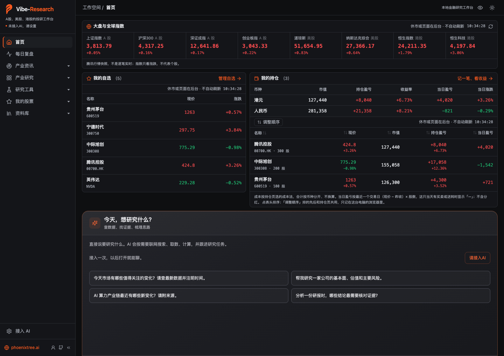

<details>
<summary>浅色主题</summary>

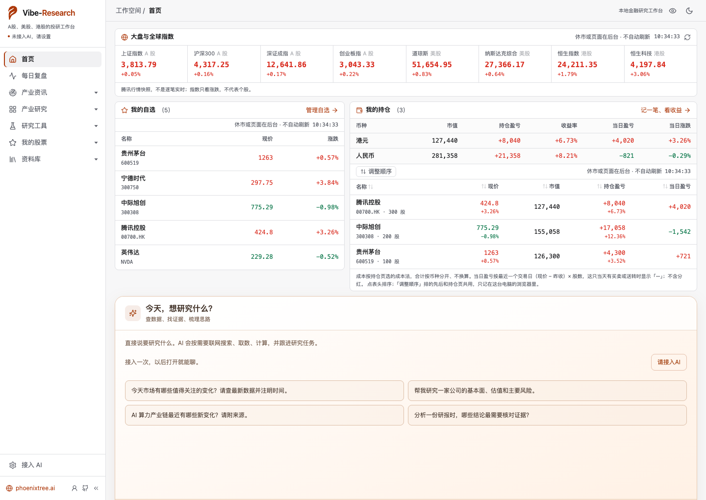

</details>

首页先看指数、自选和持仓，往下是和 AI 的对话，最下面按 6 个一级栏目进入各个功能；左侧栏目默认常驻展开，可以收起。

<table>
<tr>
<td width="50%" valign="top">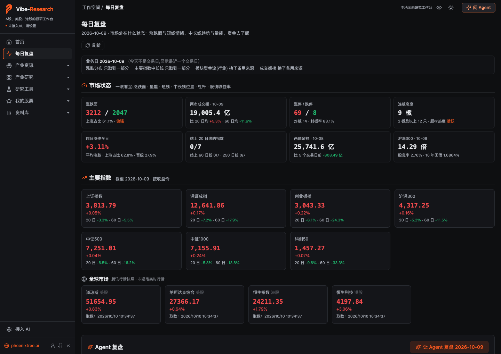<br><b>每日复盘</b>：涨跌面、量能、连板高度、两融、主要指数的中长期位置</td>
<td width="50%" valign="top">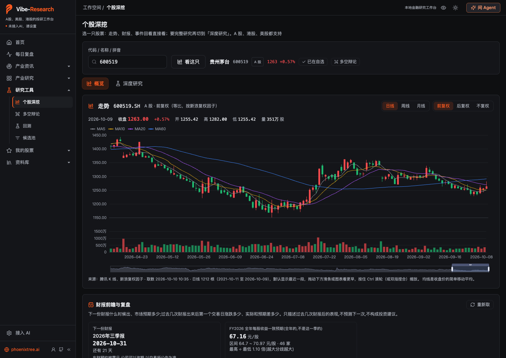<br><b>个股深挖 · 概览</b>：K 线（可切复权）、财报前瞻与复盘、事件回看</td>
</tr>
<tr>
<td width="50%" valign="top">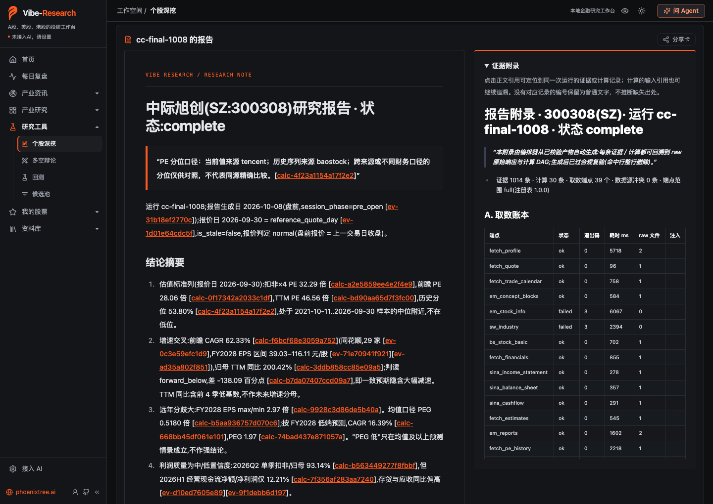<br><b>六阶段研究报告</b>：正文里的数字带证据或计算编号，右侧证据附录能回查到原始数据</td>
<td width="50%" valign="top">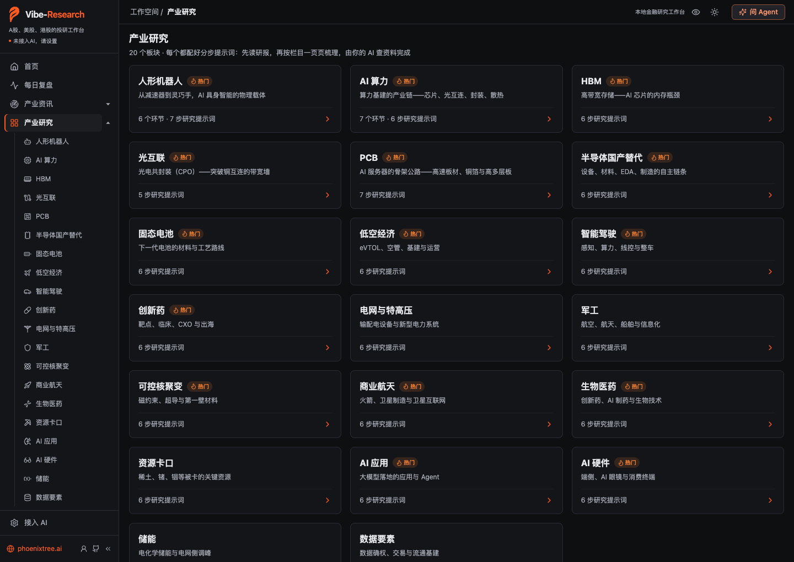<br><b>产业研究</b>：20 个板块，每个配一组分步研究提示词</td>
</tr>
<tr>
<td width="50%" valign="top">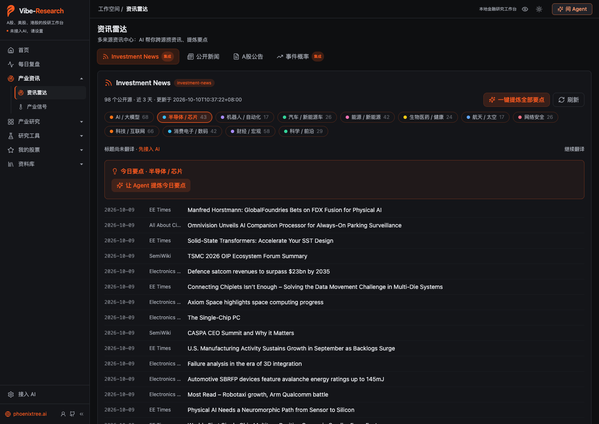<br><b>资讯雷达</b>：12 个行业的公开信源，近 3 天资讯</td>
<td width="50%" valign="top">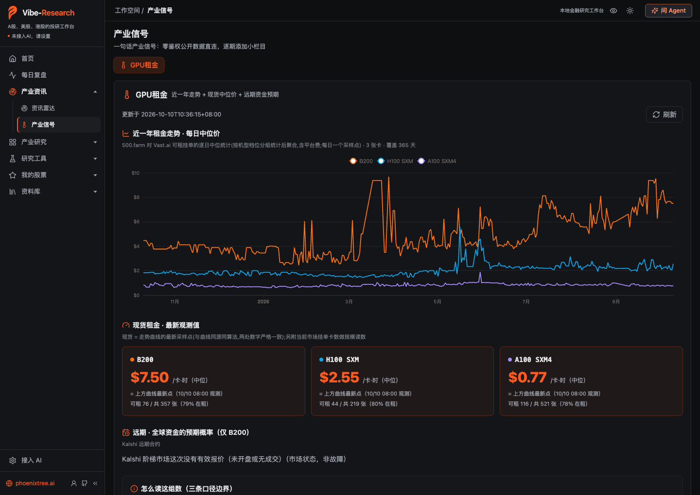<br><b>产业信号</b>：GPU 租金一年走势与现货价</td>
</tr>
<tr>
<td width="50%" valign="top">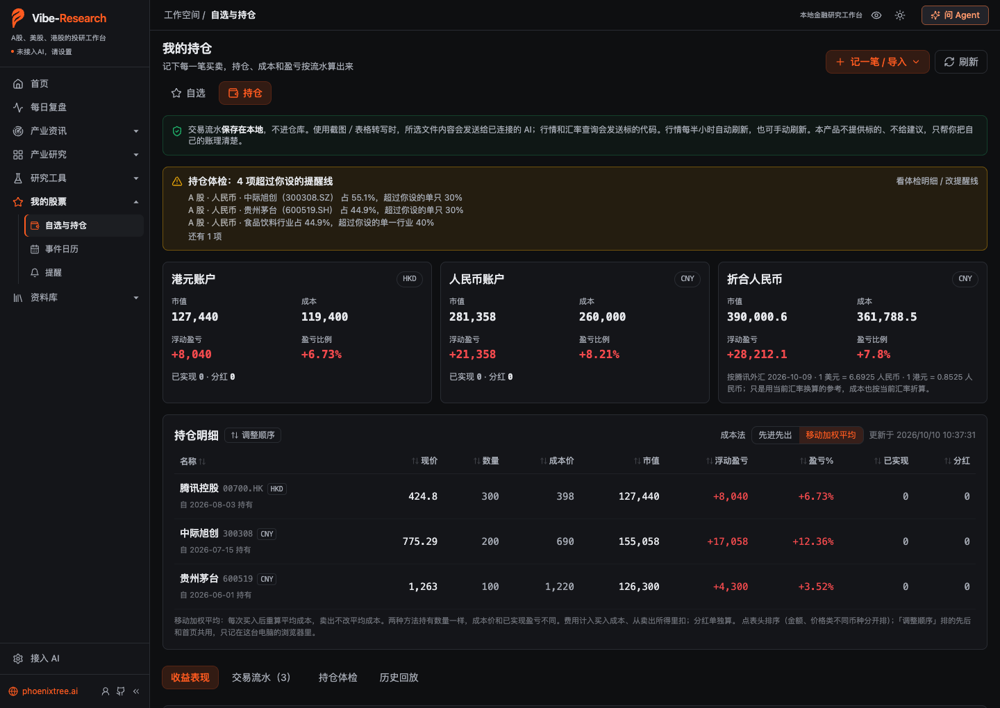<br><b>我的持仓（示例数据）</b>：按交易流水算持仓、成本和盈亏，持仓体检提示集中度</td>
<td width="50%" valign="top">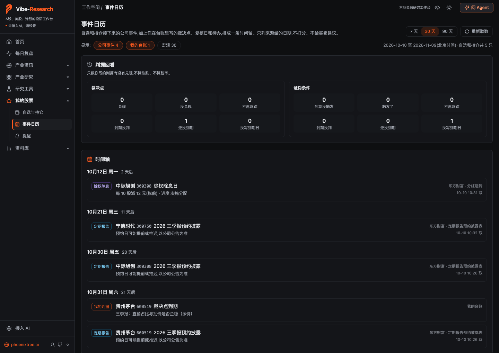<br><b>事件日历</b>：自选和持仓的除权、财报预约，加上自己写的裁决点</td>
</tr>
<tr>
<td width="50%" valign="top">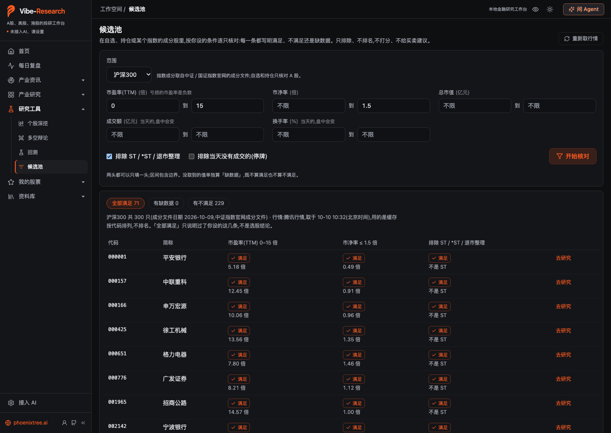<br><b>候选池</b>：按条件逐只核对指数成分股，只排除、不排名</td>
<td width="50%" valign="top">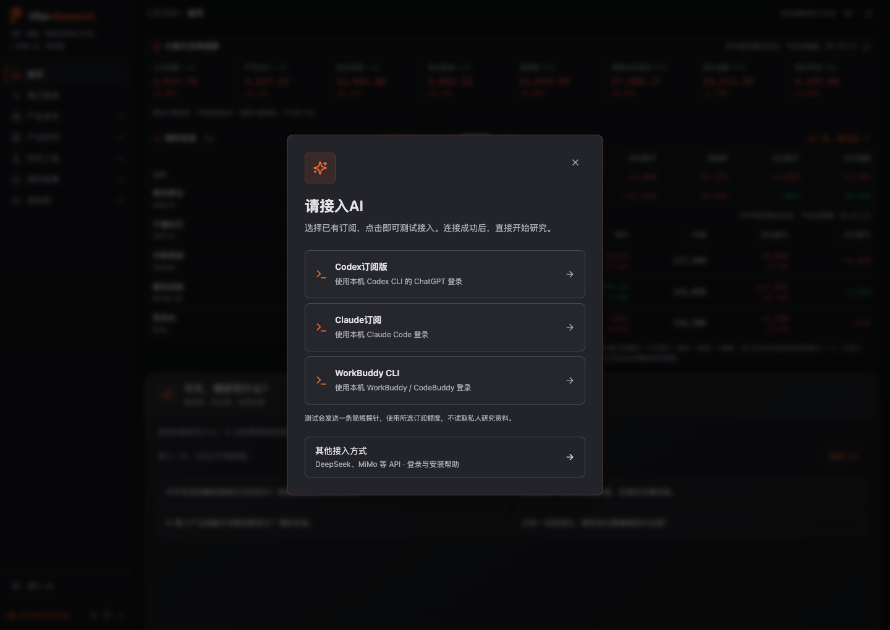<br><b>接入 AI</b>：第一次打开时选订阅或模型 API</td>
</tr>
</table>

截图拍摄于 2026-10-10（开发版，休市），使用单独的演示工作区，未接入 AI。自选、持仓、论点和判据是为截图录入的示例数据，不是真实持仓；研究报告是 2026-10-08 开发验证时跑完的一份报告，原样展示；其余都是拍摄时页面取到的公开数据。截图只展示界面，不构成投资建议（[截图说明](assets/screenshots/2026-10-10/README.md)）。

## 功能

左侧共 8 个一级栏目，有几个页面的收成二级（点一级栏目旁的箭头展开；侧栏收成图标时，点图标在旁边弹出二级）：

<table>
<thead>
<tr><th nowrap>一级栏目</th><th nowrap>二级栏目</th><th>可以做什么</th></tr>
</thead>
<tbody>
<tr><td nowrap>首页</td><td nowrap>—</td><td>先看大盘与全球指数、我的自选、我的持仓（市值、持仓盈亏、当日盈亏，开盘时价格自动刷新），再往下和 AI 对话，从分类目录进入各个功能</td></tr>
<tr><td nowrap>每日复盘</td><td nowrap>—</td><td>打开就看市场处在什么状态：涨跌面、量能、短线情绪（涨停 / 跌停 / 炸板、昨日涨停今日表现、晋级、连板股）、指数中长期位置、两融、股债收益率、行业资金和龙虎榜；涨停股按行业分档并和前两个交易日比</td></tr>
<tr><td nowrap>产业资讯</td><td nowrap>资讯雷达</td><td>新闻、公司公告与事件线索，找出需要进一步核对的信息</td></tr>
<tr><td nowrap>产业资讯</td><td nowrap>产业信号</td><td>GPU 租金、月度产业数据、原材料与招聘等上下游信号</td></tr>
<tr><td nowrap>产业研究</td><td nowrap>20 个板块</td><td>侧栏里直接列出 20 个产业板块（点「产业研究」本身是全部板块一览），每个板块一页，配一组分步研究提示词：先让 AI 读研报，再按栏目一页页梳理技术路线、产业链和格局；可以复制到自己常用的 AI，也可以填进「问 Agent」。板块内容由你的 AI 查资料产出，产品不预先填写</td></tr>
<tr><td nowrap>研究工具</td><td nowrap>个股深挖</td><td>选一只股票（A 股、港股、美股），分两个分页：<strong>概览</strong>直接看 K 线、财报前瞻与复盘、事件回看（A 股看业绩预告、股东增减持、回购、机构调研、龙虎榜和限售解禁，港股、美股看业绩公布前后的涨跌）；<strong>深度研究</strong>分阶段整理公司业务、财务、盈利预期、估值和风险，生成带证据的研究报告，可生成分享卡</td></tr>
<tr><td nowrap>研究工具</td><td nowrap>多空辩论</td><td>目前只做 A 股：对照支持与反对的观点，找出遗漏的前提、风险与反证</td></tr>
<tr><td nowrap>研究工具</td><td nowrap>回测</td><td>用对话描述要验证的想法，用历史数据检查规则表现，和指数对照、出图</td></tr>
<tr><td nowrap>研究工具</td><td nowrap>候选池</td><td>在自选、持仓或指数成分股里按你设的条件逐只核对，每条写明满足、不满足还是缺数据；按代码排列，不排名</td></tr>
<tr><td nowrap>我的股票</td><td nowrap>自选与持仓</td><td>两个分页。<strong>自选</strong>按名称、拼音或代码批量添加，刷新行情、持续跟踪，A 股显示离交易所异常波动标准还有多远，已持有的标「持有」；<strong>持仓</strong>按交易流水记账，结合行情看持仓、盈亏和收益率，做持仓体检、回看历史大跌期，不能下单交易。点股票名进个股深挖</td></tr>
<tr><td nowrap>我的股票</td><td nowrap>事件日历</td><td>自选和持仓接下来的财报、解禁、除权除息，和台账里的裁决点、复核日排在一条时间轴上，每条带来源</td></tr>
<tr><td nowrap>我的股票</td><td nowrap>提醒</td><td>A 股交易日收盘后自动整理收盘摘要、自选变化和到期的判据，放进收件箱，可推到系统通知或飞书 / 企业微信 / 钉钉群</td></tr>
<tr><td nowrap>资料库</td><td nowrap>我的研报</td><td>导入、查阅和检索自己的资料，围绕资料提问并核对原文</td></tr>
<tr><td nowrap>资料库</td><td nowrap>研究记录</td><td>按时间回看、搜索和管理研究、回测与辩论报告</td></tr>
<tr><td nowrap>接入 AI</td><td nowrap>—</td><td>选择订阅或模型 API，测试成功后全站共用；固定在侧栏底部</td></tr>
</tbody>
</table>

旧地址（/watchlist、/portfolio、/stock-data）照样能打开，会跳到新位置；原来个股页里的多空辩论分页（?tab=debate）会跳到「多空辩论」页，并带上原来选的股票。

### 首页

打开首页先看自己的股票，再往下才是对话：

- **大盘与全球指数**：A 股上证指数、沪深300、深证成指、创业板指，美股道琼斯、纳斯达克综合，港股恒生指数、恒生科技。
- **我的自选**：现价和涨跌幅，先列 10 只，可以展开全部；点名字进个股深挖。
- **我的持仓**：股数和成本由交易流水算出，列出现价、市值、持仓盈亏（金额和百分比）、当日盈亏；合计按人民币、港元、美元分开，不换汇相加。当日盈亏 =（现价 − 昨收）× 股数；这只股票最近一个交易日有买卖或送转时不能只按昨收算，就不算并把原因写在「—」下面。「最近一个交易日」先看行情自带的成交日期，节假日里也认得出（行情停在节前那天）。没取到现价或昨收的显示「—」并说明，不当成 0；流水里有数据不对、没参与计算的，和持仓页一样提示。
- **价格自动刷新**：自选和持仓在交易时段、页面在前台时约每 3 秒取一次；指数在 A 股、港股、美股任一开盘时每 15 秒取一次。港股算到 16:10，收盘竞价定下的收市价也会刷到。休市或切到别的窗口时不刷，指数条可以手动刷新。行情是腾讯快照，不是逐笔实时。
- 打开隐私模式时金额遮住，百分比照常显示。首页这部分只读，不会开始研究、调用模型或改台账。

再往下直接提问；其他栏目右上角也能打开对话，围绕当前页面继续聊。

接入订阅或模型 API 后，AI 会按问题需要联网搜索、读取网页、取数和计算；解释概念、梳理思路、翻译这类不需要新数据的问题一般直接回答。完整研究要你确认后才启动，对话不会自动变成一轮研究。没接入 AI 时也可以先浏览各个栏目。

每条回答下面列出「本轮来源」：取了哪些数据（来源、取数时间、条数，只取到一部分或用的是上次的快照会写明）、读了哪些网页（附链接）、引用了你哪份研报的第几页，没成功的单独列出；这一轮什么都没查，也会写明回答里的内容没有来源可以核对。

对话回答里的每个数字都会核对出处：要能在你发的消息、当前页面、取到的数据和网页或此前的对话里找到，或者是回答里写出的算式算出来的。找不到的只把那个数字换成「（略※）」，末尾注明有几处，其余内容照常显示。日期、年份、编号、指数名（如沪深300）、均线天数这类不是数据的数字不核对，写明「假设」的举例也不核对。核对的是数字在这些内容里出现过，不是用得对不对；一手多少股、涨跌幅限制这类常识数字，对话里没有出处时同样会被略去。

### 每日复盘

「每日复盘」打开就看市场处在什么状态，可以让 Agent 按页面上的数据写一份复盘。交易时段默认看今天（收盘前数字还会变），也可以切到上一个交易日看完整的一天。从上到下：

- **市场状态**：八格一眼看全 —— 涨跌家数、两市成交额和 20 / 60 日均值比、涨停 / 跌停 / 封板率、最高连板、昨日涨停今天的平均涨跌、站上 20 / 60 / 250 日线的指数个数、两融余额的 5 日变化、沪深300 市盈率与股息率和 10 年国债收益率。
- **短线情绪**：涨跌分布（涨停到跌停 23 档）和沪深京三所家数、成交额；赚钱效应（昨天涨停的今天平均 / 中位数涨跌、上涨比例、又涨停的比例）与亏钱效应（跌停、炸板、昨日涨停今天跌 5% 以上）；晋级（首板 → 2 板、2 板 → 3 板……各有几只又涨停）；连板股（连板数、首封时间、当天价格与成交额、流通市值、行业、同花顺题材）。
- **中长线**：八个主要指数的 5 / 20 / 60 / 250 日和年初至今涨跌、离一年高点多远、在 20 / 60 / 250 日线上方还是下方；两市成交额近 60 日柱图和均值线（盘中那根没收完，不和整天均值比）；两融余额走势；沪深300 股息率、盈利收益率和 10 年国债收益率的差。
- **资金去了哪**：行业资金净流入 / 流出居前（东财取不到时换新浪，口径写明）、全市场成交额前 20、龙虎榜净买入 / 净卖出居前。

每块写着自己的数据日；涨跌分布、行业资金、成交额榜三个来源只给当天，看上一个交易日时标「此刻快照」。没取到的块直接说没取到和原因，不显示成 0。「偏强」「活跃」这类标签按写死的阈值算，规则写在标签上；全部是公开数据的整理，不预测涨跌。

涨停股按东财行业归类，和前两个交易日比，按只数分四档：**连续集中**（今天同一行业 ≥ 3 只涨停，前两个交易日每天也 ≥ 2 只）、**今天集中**（今天 ≥ 3 只，前两个交易日不是每天都 ≥ 2 只）、**零散**（2 只）、**单只**。每个行业列出涨停的股票、连板数、最高板（连板数最多、同样多时首封最早的那只）和梯队（各连板高度各几只），以及出现最多的同花顺题材标签。档位是按只数的固定规则，不代表能不能持续，也不是推荐；行业名是东财给的简称（最长 4 个字），题材标签是同花顺的市场叙事，不是核验过的因果。前两个交易日的涨停池没取到时写明分不出是不是连续，不当成 0。让 Agent 复盘时，板块部分按这四档的顺序写，小标题不超过 25 个字，不用渲染词。

### 产业研究

「产业研究」列出 20 个产业板块（人形机器人、AI 算力、HBM、光互联、PCB、半导体国产替代、固态电池、可控核聚变等）。每个板块配一组分步研究提示词：第 1 步让 AI 先读你资料库里和这个板块相关的研报，再找今年和去年的公开行业研报；之后一步产出一页，比如总览、技术路线、产业链与价值量、全球格局、确定性地图（光互联、HBM、人形机器人、PCB 四个板块用各自的栏目）。年份按打开页面当天的日期写，不写死。

每一步可以「复制」贴到你常用的 AI，也可以点「发给 Agent」填进右上角「问 Agent」的输入框，看过再发送，不会自动发出；回答下面点「存进记录」，攒成这个板块的研究笔记。

板块内容不预先填写：提示词只给研究方法，内容由你的 AI 当场查资料产出，每个数字都要求写来源和年份，查不到写「未查到」；只讲产业，公司只按在产业链里的位置描述，不涉及估值和买卖。

### 候选池

「候选池」在一个范围里按你设的条件逐只核对。范围可以选自选、持仓，或沪深300、中证A500、中证500、中证1000、中证2000、上证50、科创50、创业板指的成分股（成分取自中证 / 国证指数官网的成分文件）。条件可以设市盈率（TTM）、市净率、总市值、当天成交额、换手率的区间，以及排除 ST / \*ST / 退市整理和当天没有成交的（停牌）；行情来自腾讯。

每只、每条都写明满足、不满足还是缺数据，并列出实际的值。结果分「全部满足」「有缺数据」「有不满足」三组，按代码排列，不排名、不打分；「全部满足」只说明过了你设的这几条。来源没给的值单独算缺数据，不当成 0；亏损公司的市盈率是负数，照实显示。开盘前几乎所有股票都还没有成交，这时「停牌」这一条记为缺数据。自选和持仓里的基金、债券、港股、美股不核对，页面上写明。点「去研究」会打开个股深挖并选好这只股票。

### 个股深挖

「个股深挖」页先选一只 A 股、港股或美股，再分「概览」「深度研究」两个分页。选股票只是打开这只，不会自动开始研究。A 股的页头有「多空辩论」按钮，带着这只股票去多空辩论页。

「深度研究」按 **公司画像 → 财务 → 盈利预期 → 估值 → 风险 → 报告** 六个阶段展开。除了报告，还保留每个阶段用到的资料、计算依据、来源冲突与数据缺口：缺数据就记为缺口，不当成零；无法验证的结果不写成已完成。

港股、美股同样走这六个阶段，口径按市场调整：开头先核对公司身份（行情来源和公司资料来源报的公司名要对得上，对不上就写明没核实）；财务只用研究当天已经公布的数（按公告日筛选），季度、全年、年初至今累计分开标，近四季合计由累计值推算，不按自然季度硬拆；股价、市值和利润币种不同时（如腾讯港元报价、人民币列报）先按汇率换算再算市盈率，汇率照抄汇率数据；一致预期取当前财年和下一财年；报价参考日按市场取美股标普 500 或港股恒生指数；市盈率历史分位用百度股市通的 PE TTM 序列。港美股不披露扣非，扣非市盈率一格写明未获取；单季环比本版不算。

报告「推断」里每条标一档可信度：已披露证实 / 有依据的推断 / 未核实线索 / 被反证，除「未核实线索」外都要写出证据或计算编号。报告开头附「口径提示」：同一计算混用了币种、TTM 与单季计算的期末不一致、按 A 股定期报告披露期限财报不是最新一期、扣非 × 4 年化被季节性放大或压低时，会写明。报告里没引编号、本次取到的数据和计算里也找不到出处的数字（同行引了用户资料的，资料片段里找得到也算有出处），交付前换成「〔未核实〕」，报告开头写明有几处，运行标为不完整；日期、编号、写明是假设或情景的行和表格不算。

「概览」直接看 K 线：5/10/20/60 日均线和成交量，日 / 周 / 月三档，A 股可切换前复权、后复权、不复权；只看行情，不画买卖点，北交所暂不支持。

K 线下面是「财报前瞻与复盘」（A 股、港股、美股都能看）：下一份财报的日期（A 股取东财预约披露日，公司可以改期，以交易所公告为准；港美股取 Yahoo，写明是估计日期还是公司公布的日期）、一致预期的均值和区间（A 股是全年每股收益，港美股是本季每股收益），A 股有下一期业绩预告时一并列出；过去几次财报发布后第一个交易日的涨跌（复权收盘价，含当天大盘涨跌；几份财报落在同一天的合并算一次），和此前几次的平均绝对涨跌对照，以及实际和预期差多少（A 股对照业绩预告区间，港美股对照一致预期）。数字都由计算库算出；只描述过去，不预测下一次，不出目标价。北交所的涨跌暂不支持（行情来源不支持），取不到的写进缺口。「问 Agent」会带上这张卡片。

概览里还有「事件回看」。A 股可选七类事件——业绩预告、重要股东增持、重要股东减持、回购方案、机构调研、龙虎榜上榜、限售解禁（东财数据），列出这只股票历史上每一次事件前 5 个交易日到后 20 个交易日、相对沪深300指数的累计超额收益（每天的涨跌减去指数当天的涨跌，再累加），按「事件前 5 日 / 第 0–1 日 / 第 0–5 日 / 第 0–20 日」四档给平均、中位数和上涨占比，再画一条平均路径；业绩预告另按向好（预增、略增、扭亏、减亏）和向差（预减、略减、首亏、增亏）分组，龙虎榜按上榜席位合计净买入 / 净卖出分组，限售解禁按实际可流通股数占总股本 ≥ 1% / 不到 1% 分组。回购按方案第一次公告的日子算；机构调研按调研记录的公告日算（东财只保留近一年左右）；龙虎榜收盘后才公布，第 0 天从上榜日的下一个交易日算起，上榜当天的涨跌落在「事件前 5 日」；限售解禁另把已经排期、还没到的批次列在最上面（只列出来，不算涨跌）。港股、美股看「业绩公布」：港股按港交所披露易的末期 / 中期 / 季度业绩公告，16:00 收市后发的从下一个交易日算起（平安夜、除夕这类半日市午后发的仍算当天），对照盈富基金（跟踪恒生指数）；美股按 SEC 8-K 里的业绩公布（Item 2.02）：在「接入 AI」页填了 SEC 联系方式（英文姓名和邮箱，SEC 要求每个访问者留下）就用 SEC 官方全文检索，大银行这类也能取全；没填用东财转载的申报，大银行每年上千份债券申报翻不完，可能取不到，结果里会提示去填。第 0 天是美东提交日（多数公司收市后发，主要看「第 0–1 日」），对照 SPY；外国公司（ADR）用 6-K 报业绩，取不到；港美股日线只能取到约 10 年前，更早的事件不算。同一天的几条公告算一次；窗口里有停牌的照列、不进平均；最近的还没满 20 个交易日的只进已有的几档；两次相隔太近、窗口重叠的会标出来；少于 8 次不给平均，只列逐次结果。A 股用前复权日线，沪深300指数是价格指数、不含分红；港美股用 Yahoo 拆股调整后的收盘价，对照的 ETF 也是收盘价、不含分红。港美股的股东增减持这一版没做。回购多数公司只做过几次、机构调研只有近一年，次数常常不到 8 次，这时只列逐次结果。点「开始回看」才取数，「问 Agent」会带上结果；只描述过去，不预测、不给买卖提示。

同一家公司研究过两次以上，打开报告时可以另选一次来比较：关键数据逐条对齐，分「变了 / 新增 / 消失」，每个数都能追回各自的证据编号；报告按章节列出哪几行改了。只并列两次写了什么，不解读涨跌；证据和计算编号每次都会重新生成，比较时已经忽略。

换一家 Agent 再研究同一只股票，「各次研究过程对比」能把这几次的研究过程并排看：取了多少证据、实际引用多少、报告里引了证据编号的数字有多少对得上、几个阶段资料齐全、几个阶段一次就过校验、写出了几条缺口、用了多久。只比研究过程，不比结论对错，也不比收益；不打总分、不排名次，读不到的显示「—」。取数范围不同、只跑了部分阶段时会先说明，这时数量不能直接比。
对比出来以后，下面会列出本机已登录的订阅 Agent（Codex / Claude Code / WorkBuddy），点一下就用那家的订阅、同样的取数范围再研究这只股票，只这一次用它，不改你在「接入 AI」里的设置。对比表可以存进研究记录；研究归档旁的「本周对比周报」把近 7 天被两家以上 Agent 研究过的股票汇成一份，只存在本机。

报告通过校验后可以生成「分享卡」：竖版（手机）或横版的 PNG，也能复制成文字。卡片只放这次研究取到的原始数据（股价、总市值、市盈率、市净率、营业收入、归母净利润、一致预期每股收益，各带日期和来源；同一期几个来源的值不一样就都列出，图上每项最多两个，文字版最多三个）、用了多少证据 / 来源 / 计算、哪几项数据有缺口，以及一句声明；不放报告里的判断、评分和目标价。

研究中可以看进度、请求中止，刷新页面后状态还在；发出中止请求不代表已经停止，页面会分开显示这两种状态。报告、证据和计算记录都存进「研究记录」。

### 我的研报

导入 PDF、DOCX、TXT、MD 或 CSV，查阅、检索，围绕资料提问。回答里的引用能回查原文，文本型 PDF 带页码；扫描版 PDF 要先做文字识别。**有引用不代表推论一定正确，仍需核对原文与计算条件。**

原文件在本机保存和解析，检索命中的正文片段才会发给所选模型；本地保存不等于全程离线。

### 多空辩论与回测

**多空辩论**（研究工具下单独一页，目前只支持 A 股；个股深挖页头的按钮会带上当前股票）：不同分析视角围绕同一份资料，给出支持理由、风险和反驳，找出尚未解决的分歧。

**回测**：用自然语言描述要验证的规则，缺条件会继续追问，条件齐了再用历史数据跑。跑不了或不支持的条件会直接说明，不把没执行的任务写成回测结果。

- 和指数对照：A 股沪深300指数、美股标普500 ETF（SPY）、港股盈富基金（02800.HK，跟踪恒生指数）；取不到时退回所测标的自身的等权买入持有，并写明。
- 43 项数值指标，附月度 / 年度收益表和最深 5 段回撤；另把费用和滑点设为零、同一套信号再跑一遍，给出扣费前后对照和成本吃掉的百分点；报告下方画累计收益对基准、水下回撤、月度收益热力图、年度收益柱 4 张图，图里的数和报告同源。图只在当次会话里显示，存进「研究记录」的是报告和年度收益、回撤段附表。
- 稳健性检验（夏普置信区间、分段检验）和邻近参数敏感度网格，页面写明不代表最优参数，也不代表未来表现。
- 内置四种规则：买入持有、均线交叉、RSI 均值回归、RSRS 择时。RSRS 按光大证券 2017 年公开研报的公式自己写（每天用最近 18 天的最高价对最低价回归取斜率，看斜率的标准分有没有越过 ±0.7），研报参数是在沪深300指数上定的，用在个股不一定成立；前 617 根日线只用来算指标、不持有，所以区间要更长（默认参数下波段约 3.5 年、长线约 4.5 年起，不够会直接说明还差多少）；平仓记录少于 10 条时，报告写明结论说明不了有效还是无效。只用于历史回测，不给当天的读数。
- 一次运行里的多只标的合成等权组合；A 股只回测个股，ETF、指数、可转债会被拒绝。
- 回测最后一天能卖的按收盘价平仓；最后一天才买进的部分（A 股 T+1；最后一天加仓的只留加的那部分）、收盘封在跌停、当天没有行情的不编一笔卖出，按收盘价计入期末净值，报告里写明是哪几只。

两者都要先接入 AI，报告存进「研究记录」。历史表现不代表未来结果，也不是交易建议。

### 自选与持仓、研究记录

「自选与持仓」分两个分页：「自选」管关注清单，已经持有的标「持有」；「持仓」按交易流水记账，收益表现、交易流水、持仓体检、历史回放在页面下方分页切换。点股票名进个股深挖。「研究记录」按时间保存研究、回测和辩论报告。A 股、美股、港股代码都能用。

- 找股票：个股深挖、多空辩论、持仓（记一笔）共用一个搜索框，输入「gzmt」「茅台」「600519」都能找到；自选可以粘贴一串代码、中文名或拼音首字母批量添加，有歧义的会列出候选。搜索接口不通时退回只认代码，并给出提示。
- 异动接近度：A 股自选显示离交易所「异常波动 / 严重异常波动」标准还有多远：3 日、10 日、30 日的累计偏离（区间涨跌幅减去基准指数同期涨跌幅）对照标准，以及 10 日内已有几次同向异常波动。标准取自沪深北交易所 2026 年修订的交易规则，按公开规则推算，以交易所公告为准；只看离标准多远，不判断方向、不预测。北交所（行情来源不支持）、基金、债券、港美股不算，页面写明；沪深主板「换手率放大」那一条日 K 里没有换手率，也写明没算。
- 交易流水：持仓按一笔笔流水记——期初持仓、买入、卖出、现金分红、送转拆股，按日期重放出当前持仓、已实现盈亏和分红；成本法可选先进先出或移动加权平均。数据不对的流水逐条写原因、不参与计算。各币种分别合计，另给一行按当前汇率折合的人民币参考（写明汇率和日期）。以前一只一条的持有记录会自动转成「期初持仓」流水，转之前先备份到数据目录的 `ledger/持仓迁移备份-日期/`；同一代码已经有自己记的流水时不自动转，由你来选。
- 收益率：按币种分开给时间加权收益（看所选的票本身走得怎么样）和资金加权收益（XIRR，看这些钱实际赚了多少），不满一年不给年化。A 股用不复权价、按流水里的送转换算股数；港美股按流水里的送转拆股还原成当时的价格，所以送转拆股要记上。取不到价格的整只不算、写进缺口，不拿成本价凑市值；价格大约能取到近 5 年，更早就卖光的不算，写明几只。流水里没填费用的买卖按 0 算，说明里写明几笔、收益率可能偏高。
- 从表格批量导入流水：选 CSV 文件或从表格软件复制粘贴，在本机按列名解析、不发给 AI；常见券商导出的列名和 GBK 编码都认。每行和手动记一笔过同一套检查；表格软件吃掉开头 0 的纯数字代码（如 1、700）一律拒，免得把 A 股记成港股。先预览（和已记的重复、写进去会卖超的、已记的会因此算不了的都标出来），勾选的行要么全写、要么全不写，写之前先备份到 `ledger/持仓导入备份-日期/`。
- 持仓体检：按币种分别算集中度、年化波动、最大回撤、单日 95% VaR / ES、每只的风险贡献和两两相关性，以及行业暴露（A 股按申万一级；港美股按 GICS 一级，来自东财公司资料，美股按东财给的细分行业对回一级），每个行业下面列出是哪几只；ETF、基金这类没有行业资料的单独一组，不算进单一行业提醒线。提醒线自己设，超线时在持仓页顶部提示；只给数字，不出综合分，缺数据的写进缺口。
- 历史情景回放：按现在的持仓比例，把几段历史大跌期重放一遍——A 股 5 段（2015 年股灾、2016 年熔断、2018 年、2020 年 3 月、2021–2024 年），港股、美股各 4 段，并排看组合涨跌、期间最大回撤、最差单日和同期指数，点开一段看走势图和每只的贡献。按币种分开、不换汇；当时还没上市或没有价格的写进缺口，有价格的不到这一组市值一半时不给组合数字。A 股能回到 2015 年，港美股约 10 年；A 股的 ETF、指数、可转债这一版回放不了（港美股 ETF 可以）。点「开始回放」才取数；只回看，不预测、不给操作提示。
- 防篡改核对：每次研究结束、每次在软件里保存或删除记录，都在本地登记簿里记一个指纹。「研究记录」页最下面点「核对」，能查出报告、证据、原始数据和台账记录有没有被人绕开软件改过或删掉，并写明是哪几个文件。登记簿和数据在同一个文件夹，能改数据的人也能整份重写登记簿，所以页面会给一个「链头」，复制到别处保存，以后粘回来比一下就能发现。

自选股和持仓还支持让 AI 从截图或表格识别出草稿，**核对后手动确认才保存**，上传不会直接改写台账。识别时选定的内容会发给当前 AI，请先去掉无关的敏感信息。本机暂存件在成功、失败或取消后都会清理，请保留原文件以便核对；清理本机暂存件不代表模型服务商删除了已收到的内容。

### 定时提醒

程序开着时，A 股交易日收盘后会自动整理三份消息，放进「提醒」页的收件箱：

- **收盘摘要**（默认 15:40）：主要指数涨跌、涨停 / 炸板 / 跌停家数、最高连板、主力资金净流入和净流出前三的行业、龙虎榜上榜只数。
- **自选变化**（默认 16:15）：自选里每只的当日涨跌（港美股标出行情日），A 股自选上次以来的新公告标题（最多查 30 只），以及离交易所异常波动标准七成以上的 A 股自选（按规则推算，以交易所公告为准）。
- **判据到期**（默认 16:30）：台账里的裁决点、证伪条件到了日子，列出写下以来的公司公告标题（A 股），提醒回来标记。周末到期的在下一个交易日提醒，同一条只提醒一次。

只列事实，不给买卖建议；某块数据没取到就写「没取到」，不写成 0。时刻按北京时间，可以改，也可以关掉；周末和节假日不运行，交易日历取不到时当天不运行，并在收件箱说明。电脑关机或程序没开时不会运行，当天再打开时，过了时刻还没跑的任务会补跑一次。

推送可选：系统通知（macOS、Linux）和飞书、企业微信、钉钉群机器人，不开也照样进收件箱。机器人地址和密钥只存在本机，页面上只显示打码后的样子。可以设静默时段（只进收件箱、不推送）；同一条内容 24 小时内只推一次。

### 事件日历

「事件日历」把自选和持仓接下来 7 / 30 / 90 天要发生的事排成一条时间轴，每条写明来源：

- A 股：定期报告预约披露日、限售解禁（写实际解禁股数）、除权除息（每 10 股派息和送转）。过了预约日还没披露的单独列出。
- 美股：财报日（Nasdaq）；只是预估的日子标「预估」。
- 港股：目前没有可用的逐只事件来源，页面上写明没查。A 股的 ETF 等基金和债券也不在这几个来源里，同样写明没查。
- 台账里写的裁决点到期日、论点复核日和待办到期日放进同一条时间轴；过了日子还没处理的放在最上面。
- 宏观日历（华尔街见闻，只取重要程度高的）默认不显示，可以打开。

A 股最多查 30 只，持有的优先。某个来源没取到会列在「没查到的」里，不当成没有事件。

到期没判的裁决点和证伪条件放在页面上方，每条附上写下以来的公司公告标题（A 股；来源每次只给最近 30 条，看不全时会写明）。对照后自己标记：裁决点选「兑现 / 没兑现」，证伪条件选「到期没触发 / 触发了」，也可以「不再跟踪」，并写一句依据；标错了可以改回待判。判过的累积成一张回看表，只数判据兑现了多少，不算涨跌、不算胜率。

## 数据与市场

数据注册表共 **168 个端点、35 层**。SEC 的 7 个端点要先在「接入 AI」页填 SEC 联系方式（或设环境变量 `VRA_SEC_CONTACT`），没填时会说明缺这一项。类别包括行情、K 线、逐笔、财务、一致预期、公告、研报、资金、筹码、南向资金、AH 溢价、公司资料、期权、指数、期货与大宗、事件驱动、可转债、SEC / FINRA / CBOE、新闻、宏观、产业温度计、招聘、管制与数据日历。A 股数据同步到 [a-stock-data](https://github.com/simonlin1212/a-stock-data) v3.10.1，美股 / 港股数据同步到 [global-stock-data](https://github.com/simonlin1212/global-stock-data) v2.0.3。

| | A 股 | 美股 | 港股 |
|---|---|---|---|
| 数据端点（各市场种类不同，见端点目录） | ✓ | ✓ | ✓ |
| 自选股、持仓、研报库、AI 对话 | ✓ | ✓ | ✓ |
| 六阶段个股研究 | ✓ | ✓ | ✓ |

- 港股、美股研究的口径差异见上文「个股深挖」。
- 端点登记在册不保证第三方服务随时可用；第三方公开数据可能延迟、缺失或有误。

端点目录见 [datasources/CATALOG.md](datasources/CATALOG.md)。

## 支持的 AI

| AI | 需要准备 |
|---|---|
| Claude Code 订阅 | 本机安装 Claude Code，并用 claude.ai 订阅登录 |
| Codex 订阅 | 本机安装 OpenAI 官方 Codex CLI（0.160.0 及以上），并用 ChatGPT 账号 `codex login` 登录 |
| WorkBuddy / CodeBuddy | 本机已安装并登录的 WorkBuddy 桌面版（自带 CodeBuddy Code），或腾讯官方 CLI `@tencent-ai/codebuddy-code` |
| 模型 API | 任意兼容 Chat Completions 的服务：DeepSeek、通义千问、智谱 GLM、Kimi、MiMo、OpenAI 等，填 API 地址、模型名和 key |

- 第一次打开首页会弹出「请接入AI」：已登录的订阅点一下就能测试并保存；「其他接入方式」进入设置页填 API。也可以先关掉弹窗浏览栏目。
- 订阅直接用你本机已登录的 CLI，不需要往页面里填 key；产品不读、不复制登录文件。
- 点「测试并保存」会先发一次真实对话，成功才生效；失败不会覆盖当前已生效的配置。
- 选了哪个就用哪个，条件不满足会直接报错，不会悄悄换成别家。
- 模型 API 要支持 Chat Completions 和工具调用（function calling）。
- 产品不附赠订阅或额度，需要对应服务可用。

**各家怎么连接：**

- **Codex**：`npm install -g @openai/codex`，在终端运行 `codex login`，用 ChatGPT 账号登录；回到「接入 AI」点「重新检测」，显示可用后点「测试并保存」。用 API key 登录的 Codex 不可用，避免订阅悄悄变成按量计费。
- **Claude Code**：用 claude.ai 订阅登录后，设置页会自动检测；API key、Bedrock、Vertex 登录不算订阅。
- **WorkBuddy / CodeBuddy**：装好并登录 WorkBuddy 桌面版就能直接识别，不用重复安装或登录；Windows 上装在别的盘或自定义文件夹，也会从「已安装的程序」登记或正在运行的 WorkBuddy 里找到。没有桌面版时，运行 `npm install -g @tencent-ai/codebuddy-code`，再运行 `codebuddy` 登录。仍找不到时（卡片显示「未安装」），先打开 WorkBuddy 再点「重新检测」，或在 WorkBuddy 卡片里填它的安装文件夹，或在启动前设环境变量 `CODEBUDDY_BIN`。
- **模型 API**：「接入 AI」→「API 接入」，选供应商，填 API 地址、模型名和 key，点「测试并保存」。

本机状态不明确时，运行 `scripts/doctor`（Windows 为 `scripts\doctor.ps1`）查看修复提示。

<details>
<summary>接入细节、工具权限与局域网访问</summary>

- 研究的每个阶段是一次独立会话，只能调用 Vibe Research 的 5 个受控工具（列文件、读文件、确定性计算、写阶段产物、写报告），订阅 CLI 的内建工具全部关闭；收工检查由产品执行，四种 AI 来源都一样。
- 页面上的对话、研究、辩论和回测都允许 AI 联网和调用产品工具。通过接口调用时仍可传 `executionMode: "direct"` 要一轮不调用工具的回答；这时个股研究、多空辩论和 Agent 回测会直接报错，不会悄悄降级。
- 订阅只认对应的订阅登录（Codex 只认 ChatGPT 登录，Claude 只认 claude.ai 订阅登录）。终端里的 API key 环境变量不会带进 CLI，避免计费方被悄悄换掉。研究只开放产品受控工具；用户配置与自动记忆保持关闭。
- 例外：Codex 会读你自己的全局 `$CODEX_HOME/AGENTS.md`（没有参数能关）。产品指令优先级更高，但里面的称呼、语气等设定仍可能生效；产品不加载你的 `config.toml`。
- WorkBuddy 自带的旧版 CLI 如果没有「禁止会话落盘」参数，整次回答会改在一次性临时目录里运行，结束后删除。
- 订阅的每次对话都会启动对应的本机 CLI，不承诺固定响应时间。
- API 模式的 key 保存在当前浏览器的本机 `localStorage`，方便下次直接使用；它不是系统钥匙串，也不承诺加密，只建议在可信的个人电脑上使用，共享电脑用完请主动清除。key 随请求发到本机后端，不写进仓库、后端配置、运行账本或日志。
- 内置供应商模板：OpenAI、DeepSeek、通义千问、智谱 GLM、Kimi、MiMo 指向各家官方 Chat Completions 地址，另有一个未实测的 `selfhosted` 自托管占位模板。截至 2026-10-08，这些模板都还没用真实 key 跑过兼容矩阵，界面标「有模板·未实测」。未实测照样能用：结构化要求写进提示词，产物仍由产品自己校验；用真实 key 实测过的模板才标「已实测」。
- 出现重新连接提示时，按页面上的具体错误处理（未登录、登录失效或连接测试没通过），不要都当成订阅过期。

详细说明见 [docs/model-access.md](docs/model-access.md) 和 [providers/README.md](providers/README.md)。

**局域网访问**（可选，默认关闭）：从仓库根目录运行 `VRA_LAN=1 bash scripts/start`；Windows PowerShell
先设置 `$env:VRA_LAN="1"`，再运行 `scripts/start.ps1`。只开放前端，后端仍绑定回环地址；
后端已启动时也可运行 `VRA_LAN=1 npm run dev --prefix desktop`。
**仅限受信任的局域网**：这是单用户工作台共享，不是账号隔离，网络内能访问端口的人都能操作。
HTTP 不加密，API key 和研究资料可能明文传输；不要暴露到公网，也不要在不可信网络开启。
代理先校验浏览器同源，再归一化 Origin；远程模型地址仍须 HTTPS，本机模型可用回环 HTTP。
详见[模型接入与局域网边界](docs/model-access.md#5-自托管模型局域网与远程访问)。

</details>

## 快速开始

### 环境要求

| 项目 | 要求 |
|---|---|
| 操作系统 | Windows 11、macOS 或 Linux；Windows 原生运行，不要求 WSL |
| Node.js | ≥ 22.18，推荐 24 LTS |
| Python | ≥ 3.11，推荐并已验证 3.12 |
| Git | 用于克隆和更新代码 |
| AI | 见[支持的 AI](#支持的-ai)；setup 不会安装 Claude Code、Codex 或 WorkBuddy |

> Node 必须是启用了 TypeScript 支持的构建（nodejs.org 官方安装包、nvm / fnm / Volta 装的都是）：`node -p process.features.typescript` 应输出 `strip` 或 `transform`。部分 Linux 发行版仓库打包的 Node 编译时关闭了这一项，启动或跑测试会报 `ERR_UNKNOWN_FILE_EXTENSION ".ts"` / `ERR_NO_TYPESCRIPT`，请换官方构建。`npm test` 前会先做这项检查并给出同样的提示。

### 安装并启动

Windows（PowerShell / CMD）：

```bat
git clone https://github.com/simonlin1212/Vibe-Research.git vibe-research-agent
cd vibe-research-agent
scripts\setup-windows.cmd
scripts\start.cmd
```

macOS / Linux：

```bash
git clone https://github.com/simonlin1212/Vibe-Research.git vibe-research-agent
cd vibe-research-agent
scripts/setup
scripts/start
```

- setup（`scripts/setup` 或 `scripts\setup-windows.cmd`）会创建 `.venv`、安装 Node / Python 依赖、初始化私有数据目录并运行体检。
- start（`scripts/start` 或 `scripts\start.cmd`）会检查安装状态和端口，同时启动本机 API 与页面，两边都可用后打开 [http://127.0.0.1:5930](http://127.0.0.1:5930)；不需要开两个终端，按 Ctrl+C 同时关闭。
- 端口：页面默认 5930、本机 API 默认 8765。默认端口被别的程序占用、或被系统保留（Windows 上 Hyper-V / WSL 常整段预留端口）时，会自动换一个空闲端口并在终端说明，浏览器打开的就是实际地址；已经开着一个 Vibe Research 时，会提示直接打开它。
  - 换了端口后，「接入 AI」里的模型 API 设置和对话记录要在新地址重新设置：它们存在浏览器里，按地址分开。同样的占用情况每次换到同一个端口；默认端口空出来后重启，就回到原来的地址和设置。
  - 想固定端口：`scripts/start --port 6930 --api-port 9765`（Windows：`scripts\start.cmd -Port 6930 -ApiPort 9765`），或设环境变量 `VRA_UI_PORT` / `VRA_API_PORT`。自己指定的端口不能用时直接报错，不会擅自换。
- macOS / Linux 不想自动打开浏览器时，运行 `scripts/start --no-open`。
- Vite 只在本机代理 `/api/*`，并在服务端补上鉴权信息。若设置了 `VRA_DATA_ROOT`，两个进程必须使用同一个值。

部署、接口与维护说明见 [AGENTS.md](AGENTS.md)；`desktop/` 是浏览器前端目录，不是 Mac 客户端。

### 免安装版（Windows / macOS）

不想装 Node、Python 和 Git，可以到 [Releases](https://github.com/simonlin1212/Vibe-Research/releases) 下载对应电脑的压缩包，包里带好了 Node 和 Python：

| 电脑 | 系统要求 | 压缩包 |
|---|---|---|
| Windows（x64） | 64 位 Windows 10 及以上 | `VibeResearch-<版本>-win-x64.zip` |
| Apple 芯片 Mac | macOS 14 及以上 | `VibeResearch-<版本>-mac-arm64.zip` |
| Intel Mac | macOS 14 及以上 | `VibeResearch-<版本>-mac-x64.zip` |

1. 解压到任意文件夹，双击里面的 `Start-VibeResearch.cmd`（Windows）或 `Start-VibeResearch.command`（macOS）。会开一个命令行 / 终端窗口，浏览器自动打开 [http://127.0.0.1:5930](http://127.0.0.1:5930)（5930 被占用时自动换一个端口，以窗口里显示的地址为准）；关掉那个窗口就退出。
2. 包没有代码签名，第一次打开会被系统拦：Windows 弹出「Windows 已保护你的电脑」时点「更多信息」→「仍要运行」；macOS 提示无法验证开发者时，在终端运行 `xattr -dr com.apple.quarantine <解压出来的文件夹>`，再双击启动。
3. 交易流水、研究记录和设置都存在这个文件夹的 `.local` 里（macOS 的访达默认不显示以点开头的文件夹，按 Command+Shift+. 就能看到）。升级时把新版本解压到新文件夹，把旧文件夹里的 `.local` 整个复制过去，再从新文件夹启动；确认没问题再删旧文件夹。
4. 接入 AI 和源码版一样：沿用电脑上已登录的 Claude Code / Codex / WorkBuddy，或在「接入 AI」填模型 API。

每个压缩包旁边有同名的 `.sha256` 文件，可核对下载是否完整。免安装版只在本机打开，不开放局域网；要局域网或云端访问、或用的是 Linux / 更早的 macOS，请用上面的源码安装。

### 远程访问（云端电脑）

在一台 macOS / Linux 云端电脑上：

```bash
scripts/setup
scripts/start --remote --no-open --public-url https://<平台给页面端口（默认 5930）分配的公网地址>
```

启动后终端会打印一条带访问口令的链接（`https://…/?access=…`），用浏览器打开就能用；之后 30 天内直接打开公网地址即可。不需要 SSH，也不用连回本地电脑。后台运行、更换口令等完整步骤见 [AGENTS.md](AGENTS.md) §3。

- 页面、静态资源和接口的每个请求都要先过访问口令；本机 API 仍只监听回环地址。
- **只用 https 公网地址**，否则页面里填的 API key 会明文传输。页面只能挂在根地址，不支持子路径。
- 拿到链接的人能用这台电脑上的全部功能，链接只给自己用；启动日志里也有访问口令，别外传。
- 云端电脑上通常没有你的订阅登录，在页面里用模型 API 接入即可。
- 远程模式的页面端口不会自动换（云平台映射的是固定端口）：5930 被占用时先停掉占用它的程序，或用 `--port` 换成平台开放的端口。

### 从 v1 升级

- 先备份自己的数据，再更新代码（`git pull`），重新运行 setup，然后到「接入 AI」重新选一次并测试。不必重新克隆。
- v1 的产品专用 Codex 登录（`.local/codex-home`）不再读取，改用你自己 `codex login` 的 Codex CLI。旧文件留在本机即可，别提交、别外传。
- 来源 id `openai` 停用：ChatGPT 订阅改成 `cli-codex`，OpenAI 按量 API 改成 `openai-api`。写了旧值会直接报错并说明改法。
- v1 的命令行参数（`--engine`、`--codex-path` 等）会报错并给出改法。
- 旧 Mac 客户端的数据（`~/.vibe-research-desktop`）不会自动迁入源码工作区；不要删除它，也不要提交到仓库。详见[源码交付说明](docs/source-delivery.md)。

### 在 Claude Code / Codex / Cursor 里调用 VR

VR 提供 MCP 接口。接上以后，在 Claude Code、Codex、Cursor 等支持 MCP 的工具里可以直接用 VR 取数、发起研究、读报告和证据；研究结果和页面里看到的是同一份。

先跑完上面的 setup，然后在仓库目录里运行（Windows PowerShell 把 `"$(pwd)/orchestrator/src/mcp.ts"` 换成 `"$PWD\orchestrator\src\mcp.ts"`）。

Claude Code（想在所有目录都能用，加 `-s user`）：

```bash
claude mcp add vibe-research -- node "$(pwd)/orchestrator/src/mcp.ts"
```

Codex：

```bash
codex mcp add vibe-research -- node "$(pwd)/orchestrator/src/mcp.ts"
```

Cursor：在 `~/.cursor/mcp.json`（只给某个项目用就放项目里的 `.cursor/mcp.json`）加入下面这段，路径换成你的仓库位置。Cursor 提示找不到 node 时，把 `"node"` 换成终端里 `which node` 输出的完整路径。

```json
{
  "mcpServers": {
    "vibe-research": {
      "command": "node",
      "args": ["/你的路径/vibe-research-agent/orchestrator/src/mcp.ts"]
    }
  }
}
```

接好后可以这样问：

- 「用 vibe-research 查 600519 最近的券商研报和机构一致预期」
- 「用 vibe-research 取腾讯控股（00700）最近一年的日 K 和关键财务指标」
- 「用 vibe-research 给 300308 跑一次研究，跑完把估值部分的数字和出处列给我」

共 8 个工具：7 个只读（端点列表、取数、研究状态、报告、证据、研究列表、知识档案），1 个发起研究（目前只支持 A 股）。连接时会附上使用说明；出错时会写明能不能重试、下一步怎么做。

- 发起研究用这台电脑的**后台默认 AI 来源**，页面「接入 AI」里的选择不算：在 `.local/config.json` 写 `provider.profile`（如 `cli-claude`），或者添加时带上环境变量，例如 `claude mcp add vibe-research -e VRA_PROVIDER=cli-claude -- node …`、`codex mcp add vibe-research --env VRA_PROVIDER=cli-codex -- node …`。研究会消耗所选 AI 的额度。
- 只取数、读报告和证据不需要 AI。

## 安全与隐私

- AI 读取公开网页时可能经第三方 Jina Reader 转发；目标网址（包括查询参数）会发送给该服务。不要提交含私密令牌、内部资料或签名下载凭据的网址。搜索请求同样会发送到对应搜索服务。
- 原始研报文件只保存在本机；模型只接收服务端检索命中的正文片段。
- 后端默认 provider 的 key 只走环境变量，不写入产品配置或仓库。
- 浏览器里填写的 API key 只保存在当前浏览器 `localStorage`，仅在调用时经本机后端转给所选模型服务商。
- 对话可使用产品提供的联网和研究工具。资料抽取等有界任务仍按任务限制执行权限。
- 资料引用格式为 `[资料:<id> p.<页码>]`，漏引、错引和未知引用会被机器校验拒绝。
- 研究阶段没有网络；取数由编排器用受控脚本完成，原始响应落盘并记录哈希。
- 本机 API 默认只绑定 `127.0.0.1`，写请求必须鉴权并使用 JSON。
- 隐私模式（右上角眼睛图标）：录屏、截图前打开，金额、股数和成本价显示成 ••••，百分比照常。只遮屏幕显示，不影响计算和发给 AI 的内容；对话按措辞识别，个别说法可能遮不到。
- 新版提示：每天访问一次 GitHub 接口（没查成隔一小时再试），查有没有新的正式版本，请求里只带当前版本号；可在「接入 AI」页最下面关掉，或设环境变量 `VRA_UPDATE_CHECK=0`（完全不联网）。
- SEC 联系方式（选填）：在「接入 AI」页填了才有，存在数据目录的 `sec-contact.json`（只在本机、只有自己可读），只交给要访问 SEC 的取数，放进发往 SEC 的请求头；页面上只显示打码后的样子。也可以用环境变量 `VRA_SEC_CONTACT` 设置，设了以环境变量为准。
- 防篡改核对：研究结果和台账记录的指纹登记在数据目录的 `audit/chain.jsonl`，只在本机，不上传。它能发现绕开软件的改动，但防不住能同时改写登记簿的人——要防这一点，把页面给的链头另存到别处。
- 输出只包含数据、分析框架、情景概率和裁决点，不提供建仓、加减仓、目标价或止损位。

## 当前边界

- 提供源码和 Windows / macOS 免安装包，界面都是本地浏览器页面。免安装包没有代码签名；Apple 芯片 Mac 包在本机构建并冒烟过，Windows 与 Intel Mac 包在 GitHub Actions 上构建，冒烟通过才上传，都没在实机上验收。Mac 客户端自 v1.2.0 起撤下，v1.1.0 的 DMG 已于 2026-09-10 从 GitHub 撤下，旧版本记录与源码归档保留。
- 内置模型 API 模板都还没用真实 key 实测（v1 时期 MiMo 的端到端验证走的是旧引擎，不沿用）；没跑过兼容矩阵的模板不会标成「已实测」。三家订阅的实测范围见 [CHANGELOG](CHANGELOG.md)。
- Windows 11 原生支持已接入：PowerShell 初始化 / 启动脚本、Windows 路径与进程处理、受控研究工具链。CI 配置包含 `windows-latest` / `macos-latest` / `ubuntu-latest`，Windows 跑的是选定的跨平台契约测试，并非全部后端测试。仍未在 Windows 实机验收，也尚未验证正常退出后的 Job Object 子进程回收保证。Windows 10 未验证。
- 港股、美股六阶段研究：2026-10-09 用 Claude Code 订阅各真跑了一只完整研究（苹果、腾讯控股）。美股按现在的判分硬测试全部通过（报告数字 142/142 对上出处）；港股只差一项：报告里还有 3 处数字真没标出处。其他 AI 来源还没在港股、美股上跑过硬测试。研究过去某天的港股时，东财会把旧报告期的公告日改成之后再次披露的日期，按公告日筛选会保守地丢掉这些期，近四季合计可能算不出（只会少用数据，不会用到研究日之后才公布的数）。ADR 与本地股的换股比例本版不处理。
- 远程访问只支持 macOS / Linux。
- 源码运行需要本机依赖环境。

## 开发与测试

### 工作方式

```text
本地浏览器工作台
首页（指数 · 自选 · 持仓 · 对话） · 复盘 · 产业资讯 · 产业研究 · 个股深挖 · 回测 · 研报库
        │
        ▼
投研层
168 个数据端点 · 六阶段研究流程 · calc · validator · 报告归档
        │
        ▼
本地 Agent 运行时（Local Agent Runtime）与模型供应商（Model Provider）
按用户所选来源路由（不是串联运行，也不互相回落）
├─ Claude 订阅 → 本机 Claude Code CLI
├─ Codex 订阅 → 本机 Codex CLI（用户自己的 ChatGPT 登录）
├─ WorkBuddy / CodeBuddy → 本机 CodeBuddy Code CLI
└─ 模型 API → Chat Completions（由产品在本机跑工具循环）
```

三级约束，不只依赖提示词：

<table>
<thead>
<tr><th nowrap>层</th><th>组成</th><th>作用</th></tr>
</thead>
<tbody>
<tr><td nowrap>提示层</td><td><code>methodology/constitution.md</code>（研究宪法）+ <code>.agents/skills/</code> + <code>calc/SPEC.md</code></td><td>定义金融研究纪律、研究流程与计算函数契约，所有 AI 来源一视同仁</td></tr>
<tr><td nowrap>执行层</td><td>受控工具白名单 + 收工检查</td><td>研究阶段只开放 5 个受控工具，订阅 CLI 关闭全部内建工具；产物缺失或校验不过就退回去接着修</td></tr>
<tr><td nowrap>编排层</td><td>orchestrator + validator + calc + gate</td><td>强制阶段、证据引用、确定性计算和合规边界</td></tr>
</tbody>
</table>

v2.0 起不再内置 Codex Harness：三家订阅直接调用使用者本机的官方 CLI，模型 API 直接走 Chat Completions，执行层与编排层由产品自己实现。

### 项目结构

| 路径 | 作用 |
|---|---|
| `desktop/` | React + Vite 本地浏览器 UI |
| `orchestrator/` | Agent 编排、validator、API、MCP、对话、资料库与报告归档 |
| `backtest/` | 确定性回测引擎与工具入口 |
| `calc/` | 确定性计算库 |
| `datasources/` | 数据端点注册表、目录和健康巡检 |
| `.agents/skills/` | 金融研究流程与取数工具 |
| `providers/` | 模型供应商模板，不包含密钥 |
| `methodology/` | 研究宪法（`constitution.md`），研究线程的最高纪律 |
| `AGENTS.md` | 部署、接口与维护说明 |
| `scripts/` | 安装、启动、初始化与体检 |
| `.local/` | 用户私有数据、配置、报告、访问口令和运行产物；已 gitignore |

### 命令行运行一次研究

Windows PowerShell：

```powershell
node orchestrator/src/run.ts `
  --symbol 300308 `
  --market SZ `
  --provider cli-claude `
  --python "$PWD\.venv\Scripts\python.exe"
```

macOS / Linux：

```bash
node orchestrator/src/run.ts \
  --symbol 300308 \
  --market SZ \
  --provider cli-claude \
  --python "$(pwd)/.venv/bin/python" < /dev/null
```

`--provider` 指定这次研究用的 AI：`cli-claude` / `cli-codex` / `cli-codebuddy` 用本机已登录的订阅，`deepseek` 等模板 id 用模型 API
（key 从模板声明的环境变量读，如 `DEEPSEEK_API_KEY`）。不传就用后台默认（`.local/config.json` 的 `provider.profile` 或环境变量
`VRA_PROVIDER`），都没有会直接报错，不会替你选。

所有平台、所有 AI 来源都只走受控工具：研究线程没有 Shell、没有网络、没有写目录权限，只能通过受控工具读取净化后的运行文件、
调用确定性计算并写当前阶段产物。

完整研究耗时取决于取数范围、模型响应与校验重试，可能需要数十分钟或更久，不承诺固定时长。进度会持续显示，结果写入 `.local/runs/<run-id>/`。
退出码：`0` complete、`2` incomplete/stale、`3` failed。

港股、美股把 `--symbol` / `--market` 换成 `--symbol 00700 --market HK` 或 `--symbol AAPL --market US`；港美股必须传 `--market`。

### 研究运行产物

- `report.md`：最终研究报告。
- `evidence.json`：本轮使用的证据，每条保留来源、资料期和原文引用。
- `calculations.json`：派生数字的输入、函数和计算 DAG。
- `conflicts.json`：跨来源冲突，不静默取舍。
- `manifest.json`：所用 AI 来源与执行保障等级、模型、版本、阶段、状态、资料召回和运行清单。
- `viewer.html`：在浏览器里查看证据与报告。

### 回归检查

```bash
npm run typecheck --prefix orchestrator
npm test --prefix orchestrator

npm run typecheck --prefix desktop
npm test --prefix desktop
npm run build --prefix desktop

.venv/bin/python -m pytest calc/tests -q
.venv/bin/python -m pytest backtest/tests -q
.venv/bin/python -m pytest .agents/skills/data-access/scripts/tests -q
```

最近本机验收记录（2026-10-11，v2.2.1 发布前）：

- orchestrator：Node 26 运行 `npm test`，**1265 项：1261 通过、4 项 Windows 专项跳过**；类型检查通过。
- desktop：**351/351**，类型检查与生产构建通过（构建只有 Vite 的打包体积提示）；Python（计算库 311、回测 583、数据脚本 580）：**1474/1474**；mypy 检查 106 个文件通过。
- 报告数字核对：拿本机 9 份历史报告重跑，一处都没遮；随机造的数字被误认成有出处 11/2700（0.41%）。
- v2.2.0 发版前两轮独立只读审计（Codex 6.1 Sol、Opus 5.5），去重后 11 条真问题全部修复；v2.2.1 修的 4 处来自 Vibe AStock 合并 v2.2.0 时的发版审计，修复补丁另做了一次独立复核（Opus 5.5），找到的 6 处全部修掉。每条都做了反向检查（把修复改回去，测试必须变红）。
- 回测页上一版（v2.1.0）用 Claude Code 订阅真跑过一次（茅台 + 宁德时代等权组合，2019–2025 均线交叉，对沪深300）；v2.2.0 改了期末结算，靠测试覆盖，没有再真跑。
- 三家订阅的研究运行范围见 [CHANGELOG](CHANGELOG.md) v2.0.0 条目；本轮未重跑全部外部取数端点或 Windows 实机。
- 历史业务验证保留在 [M40 验收](docs/发布候选与隐私验收_M40_2026-09-07.md)，不当作本版全业务验收。

项目约定：每个环节完成后先测试；重要改动做一次独立审查（Opus 5），逐条核实、修复后复验受影响范围；审查完成前不把
该环节称为“建成”，也不提交或推送。

## 更新日志

见 [CHANGELOG.md](CHANGELOG.md)。

<details>
<summary>查看与上一版 v1.2.0 的对比</summary>

对照基线为 [v1.2.0 发布说明](https://github.com/simonlin1212/Vibe-Research/releases/tag/v1.2.0)。完整变化见 [CHANGELOG](CHANGELOG.md)。

| 方面 | v1.2.0 | v2.2.1 |
|---|---|---|
| AI 底座 | 内置 Codex Harness（Codex SDK 0.153.4） | 不再内置；三家订阅直接调用使用者本机的官方 CLI，模型 API 直接走 Chat Completions |
| Codex 订阅 | 产品专用登录（`.local/codex-home`） | 使用者自己 `codex login`（ChatGPT 账号）的 Codex CLI，与 Claude Code、WorkBuddy 同级 |
| 模型 API | Agent 要求 Responses API 端点或网关；直连只对验证过的模板开放 | 一律 Chat Completions，工具循环由产品执行；模板指向各家官方地址，如实标「未实测」 |
| 研究执行 | macOS / Linux 用 hooks，Windows 用受控 MCP | 所有平台、所有 AI 来源只走 5 个受控工具，收工检查由产品执行 |
| 运行方式 | 本机运行 | 另支持装在云端电脑上，用带访问口令的链接远程打开（远程模式） |
| `AGENTS.md` | 研究宪法 | 研究宪法移到 `methodology/constitution.md`；`AGENTS.md` 改为部署、接口与维护说明 |
| 数据端点 | 117 个、30 层 | 168 个、35 层（同步 a-stock-data v3.10.1） |
| 安装方式 | 源码安装（Mac 客户端已撤下） | 源码安装，另有 Windows / macOS 免安装包 |
| 新版提示 | 无 | 每天查一次 GitHub 最新正式版本，有新版时页面顶部提示 |

</details>

## 免责声明

本项目只产出研究数据、分析框架、情景概率与裁决点，不提供任何投资动作建议。所有输出均不构成
投资建议；第三方公开数据可能延迟、缺失或有误，使用者应自行核实并承担决策责任，同时遵守各数据源
的使用条款。

## License

本仓库采用 [MIT License](LICENSE)。

**作者：** Simon 林 · X [@linsizhen](https://x.com/linsizhen) · 邮箱：[simonlin0423@gmail.com](mailto:simonlin0423@gmail.com)
